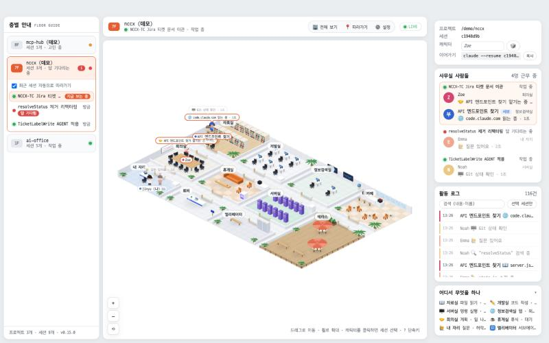
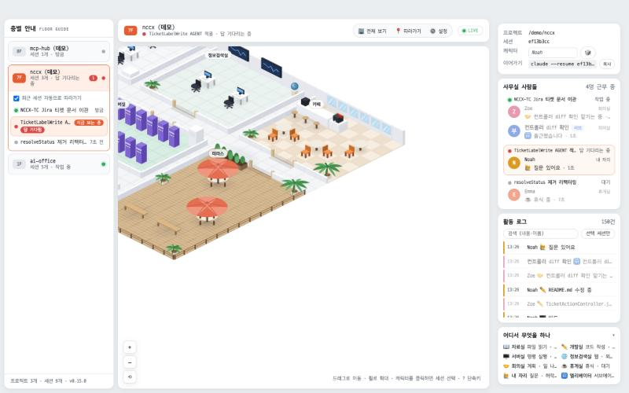
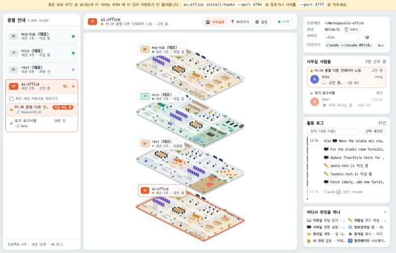
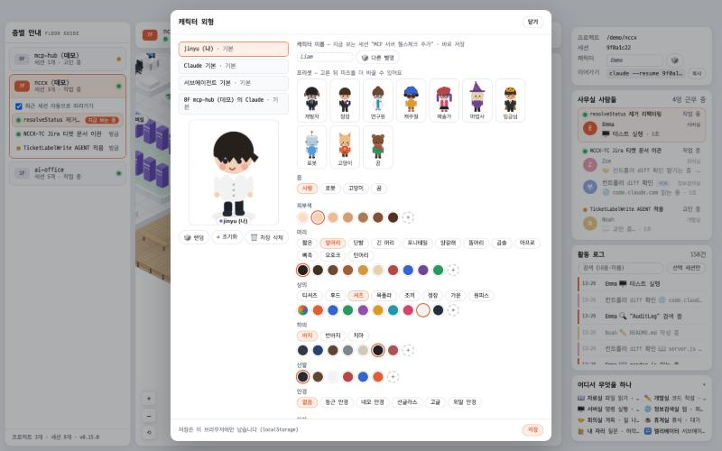
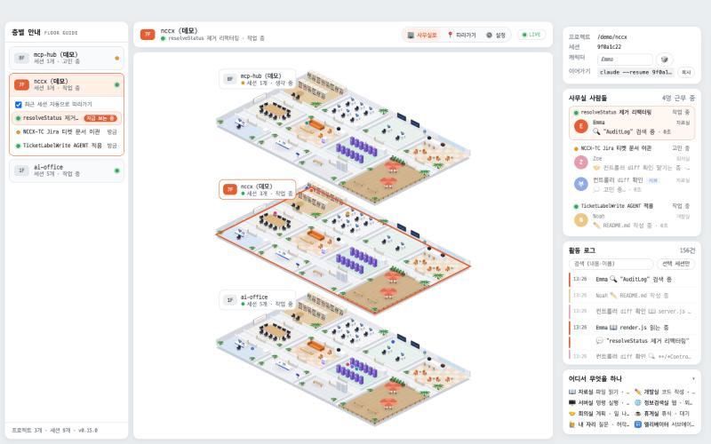

# AI Office

한국어 · [English](README.en.md)

Claude Code 가 터미널에서 뭘 하고 있는지 한눈에 보려고 차린 사무실. 내 터미널의 Claude Code 세션들이 훅(hook) 이벤트를 보내면, 세션마다 캐릭터 한 명이 아이소메트릭 사무실에서 실시간으로 움직인다. 파일을 읽을 땐 **자료실** 가서 책을 펴고, 명령을 돌릴 땐 **서버실** 랙 앞에 서 있고, 막히면 그 자리에서 턱 괴고 **고민 중**, 일을 나눠 맡기면 서브에이전트가 **엘리베이터** 타고 출근한다. git 프로젝트마다 층이 하나씩 생기고, 한 층에 그 프로젝트의 세션 전부가 보인다. 답을 기다리는 세션은 **내 자리** 에서 손을 들고, 브라우저 알림·소리·탭 제목으로도 알려 준다.



## 설치

**맥(Apple Silicon)은 앱으로:** ⬇️ **[AI-Office-mac-arm64.dmg 받기](https://github.com/cozyuj/AI-office/releases/latest/download/AI-Office-mac-arm64.dmg)** (약 40MB, Node 내장, 항상 최신 버전). 받은 뒤 `AI Office.app` 을 응용 프로그램 폴더에 넣고 처음 한 번 **우클릭 → 열기**. Homebrew 로는 `brew install --cask cozyuj/tap/ai-office`. 자세한 건 아래 [메뉴바 앱](#메뉴바-앱-tauri).

**Windows(x64)도 앱으로:** ⬇️ **[AI-Office-windows-x64-setup.exe 받기](https://github.com/cozyuj/AI-office/releases/latest/download/AI-Office-windows-x64-setup.exe)**. SmartScreen 경고가 뜨면 "추가 정보 → 실행".

**그 외(Intel 맥 · Linux 등)는 웹 버전으로:** Node 18 이상만 있으면 공통 한 줄:

```bash
npx claude-ai-office
```

(npm 대신 GitHub 에서 바로 받으려면 `npx github:cozyuj/AI-office`, 같은 동작)

이 한 줄이 (1) 앱을 `~/.ai-office/app` 에 복사하고 (2) `~/.claude/settings.json` 에 훅을 등록한 뒤 (3) 서버를 띄우고 브라우저를 엽니다. 다음부터는 같은 명령으로 서버만 다시 띄우면 되고, 레포가 바뀌었으면 설치본도 자동으로 갱신됩니다(업데이트도 같은 명령). 훅은 **새로 시작하는** Claude Code 세션부터 적용됩니다.

> 레포가 공개된 뒤 빈 npm 캐시에서 `npx --yes github:cozyuj/AI-office doctor` 가 5초 안에 끝나는 것을 확인했습니다(v0.15.0, 2026-10-21). 처음 한 번만 git clone 을 하고, 그 뒤로는 npx 캐시를 씁니다.

### `ai-office` 하위 명령

| 명령 | 하는 일 |
|---|---|
| `npx claude-ai-office` | `up` = install + install-hooks + start + 브라우저 열기 |
| `… install [--force]` | `~/.ai-office/app` 에 앱 복사 (npx 캐시와 무관한 안정 경로) |
| `… install-hooks` | `~/.claude/settings.json` 에 훅 등록 (멱등, 기존 설정은 백업) |
| `… uninstall-hooks` | 훅 제거 |
| `… start [--port N] [--no-open]` | 서버만 기동. 이미 떠 있으면 그 주소를 연다 |
| `… demo` | 가짜 세션으로 사무실을 북적이게 (화면의 ⚙️ 설정 → 데모와 같음) |
| `… doctor` | Node 버전·훅 등록 수·설치본·포트·저널·훅 포트 점검 |
| `… compact` | 이벤트 저널 즉시 압축 (서버도 매시간 자동) |

### 훅

`scripts/install-hooks.js` 가 Claude Code 의 11개 이벤트(SessionStart, SessionEnd, UserPromptSubmit, PreToolUse, PostToolUse, PostToolUseFailure, Notification, Stop, SubagentStart, SubagentStop, PreCompact)에 `node hooks/emit.js` 를 등록합니다. 셸이나 curl 없이 Node 만으로 동작하고(Windows 포함), 서버가 꺼져 있어도 1초 안에 조용히 포기하므로 Claude 를 절대 막지 않습니다.

### 포트

기본 포트는 `4777`. 바꾸려면 서버와 훅이 같은 포트를 봐야 합니다.

```bash
npx github:cozyuj/AI-office install-hooks --port 4800   # 훅을 4800 으로
npx github:cozyuj/AI-office start --port 4800           # 서버도 4800 으로
```

포트가 어긋나면 화면 위에 노란 배너로 알려 주고, `doctor` 의 `hook port` 줄에도 표시됩니다. 레포를 받아서 쓰려면:

```bash
git clone https://github.com/cozyuj/AI-office.git && cd AI-office
node bin/ai-office.js            # 또는 npm run install-hooks && npm start
```

## 화면



| 영역 | 내용 |
|---|---|
| **좌측 층별 안내** | git 프로젝트(저장소 루트) = 층. worktree 는 같은 층으로 묶이고 브랜치(⎇)가 함께 보인다. 여러 저장소를 담은 상위 폴더(git 저장소 아님)에서 연 세션은 실제로 작업하는 저장소 층으로 옮겨 간다 — 고친 파일이 가장 많은 저장소, 아직 고친 게 없으면 가장 많이 본 저장소(동점이면 그대로). 이어가기 명령은 처음 연 폴더 기준. 층을 열면 세션 목록 — `답 기다림`, `지금 보는 중` 표시. 기본은 선택한 층만 열리고, 머리의 **모두 펼치기 ↔ 모두 접기** 로 모든 층의 세션 목록을 한꺼번에 열고 닫는다(모두 접힌 상태에서 층을 누르면 그 층이 열림, 브라우저에 기억). 선택한 층의 🎨 로 그 층 인테리어 스타일(따뜻한 우드·쿨 그레이·민트·라벤더·샌드·파스텔, 기본은 층마다 자동 배정)을 고른다. "최근 세션 자동으로 따라가기"(`A`)를 켜면 최신 활동 세션으로 선택이 옮겨가고, 끄면 마지막에 보던 층·세션을 다음에 열 때 기억한다 |
| **중앙 사무실** | 드래그 이동, 휠/버튼 줌, `⟲` 초기 위치. 캐릭터 클릭 → 세션 선택, 캐릭터에 마우스를 올리면 툴팁(지금 하는 일·대상 파일·요청·브랜치·경로). 📍 **따라가기**(`F`) = 카메라가 선택 세션의 Claude 를 쫓아감. 🏢 **전체 보기**(`O`)는 층이 둘 이상일 때 나타난다 |
| **우측 패널** | 세션 카드(프로젝트 경로 · 세션 id · 캐릭터 이름 · 이어가기 명령 복사 · 끝난 세션 🗑 치우기), 사무실 사람들(방·말풍선·경과), 활동 로그(검색 `/`, 선택 세션만), 범례(제목 클릭으로 접기) |

세션 카드의 **이어가기** 는 `claude --resume <세션 id>` 를 프로젝트 폴더로 `cd` 하는 명령과 함께 클립보드에 복사합니다. 브라우저에서 보던 세션을 터미널에서 바로 이어갈 수 있습니다. 끝난 세션은 2시간 무활동이면 자동으로 퇴근 처리되는데, 세션 카드의 **🗑 치우기** 로 기다리지 않고 바로 목록에서 지울 수 있습니다.

### 어디서 무엇을 하나

| 도구 | 방 | 말풍선 |
|---|---|---|
| Read, Grep, Glob | 📖 자료실 | `server.js 읽는 중`, `"TODO" 검색 중` |
| Edit, Write | ✏️ 개발실 | `app.js 수정 중` |
| Bash | 🖥️ 서버실 | `테스트 실행`, `npm test 실행 중` |
| WebSearch, WebFetch, MCP 도구 | 🌐 정보검색실 | `"tauri vs electron" 검색 중` |
| Agent, TodoWrite, Skill, Plan | 🤝 회의실 | `API 엔드포인트 찾기 맡기는 중` |
| AskUserQuestion, 허락 요청 | 🙋 내 자리 | `질문 있어요`, `허락이 필요해요` |
| Stop (턴 종료) | ☕ 휴게실 · 카페 · 테라스 (세션마다 정해진 휴식 방) | `휴식 중`, `커피 마시는 중`, `바람 쐬는 중` |
| SubagentStart / Stop | 🛗 엘리베이터 | 출근 / 퇴근 |

휴식 방은 세션마다 하나로 정해집니다(세션 id 해시 → 휴게실 · 카페 · 테라스 중 하나). 모든 브라우저에서 같은 세션은 늘 같은 방으로 가고, 카페(창가 자리가 있는 유리벽 방)와 테라스(데크·파라솔·벤치)는 이렇게 쉬러 가는 곳이지 도구와 짝지어진 방이 아닙니다. ⚙️ 설정의 **생동감** 을 켜면 쉬는 캐릭터가 자기 휴식 방 안의 명소(카운터·창가·테이블·파라솔·벤치·난간·소파·자판기)를 10~30초마다 옮겨 다니며 `☕ 라떼 한 잔`, `🪟 창밖 구경`, `🌤️ 바람 좋다` 같은 말풍선을 띄우고, 끄면 자리를 옮기지 않고 서 있습니다.

### 층마다 다른 사무실

층(= 프로젝트)마다 **인테리어 프리셋**이 자동으로 배정됩니다(층 경로 해시, 이웃 층과는 겹치지 않게). 프리셋은 색만이 아니라 **사무실 구조**도 정합니다 — 업무 방 9개(자료실·개발실·정보검색실·회의실·휴게실·서버실·내 자리·로비·엘리베이터)의 위치가 층마다 다르고, 휴식용 편의시설 두 곳이 바뀝니다.

| 프리셋 | 편의시설 |
|---|---|
| 🪵 따뜻한 우드 · 🍬 파스텔 | 카페 · 테라스 |
| 🩶 쿨 그레이 | 세미나실 · 스튜디오 |
| 🌿 민트 | 헬스장 · 옥상정원 |
| 💜 라벤더 | 북 라운지 · 게임룸 |
| 🏜️ 샌드 | 구내식당 · 수면실 |

세션의 휴식 방(카페·테라스)은 그 층의 편의시설로 바뀝니다 — 민트 층이면 카페 대신 헬스장에서 `🏃 운동 중`, 활동 로그도 `✅ … → 🏃 헬스장` 처럼 편의시설 이름으로 적힙니다. 좌측 층 목록에서 선택한 층의 **🎨** 버튼을 누르면 프리셋을 직접 고를 수 있고, 선택은 서버(`~/.ai-office/floor-styles.json`)에 저장되어 모든 브라우저에서 같은 층을 봅니다(`자동` 으로 되돌리기 가능). 전체 보기에서도 층마다 다른 구조가 보입니다.



서브에이전트는 파란 안전모를 쓰고, Agent 도구에 적은 description 이 이름이 됩니다. 사용자 본인(`나`)은 내 자리에 앉아 있고, Claude 가 질문하거나 허락을 기다리면 그 옆으로 찾아옵니다.

## 설정 메뉴와 단축키

헤더의 **⚙️ 설정** 을 열면 아래 항목이 있고, 모두 이 브라우저에만 저장됩니다(localStorage).

| 항목 | 내용 | 키 |
|---|---|---|
| 말풍선 범위 | 말풍선을 **전체** 세션에 보일지 **선택** 세션만 보일지 | `B` |
| 브라우저 알림 | Claude 가 질문하거나 허락을 기다리면 OS 알림. 처음 켤 때 브라우저 권한을 묻는다 | |
| 대기 알림 소리 | 답을 기다리는 세션이 생기면 짧은 소리. 한 번 클릭해 켜야 브라우저가 소리를 허용한다 | `S` |
| 소리 범위 | **답 기다림만**(높은 2음) 또는 **실패·종료도**(도구 실패·세션 종료에 낮은 2음) | |
| 생동감 | 쉬는 캐릭터가 휴게실·카페·테라스 안을 옮겨 다니거나 산책하는 자율 행동 + 서 있을 때 미세 동작 | |
| 테마 | 라이트 / 다크 | `T` |
| 데모 | 가짜 세션 4개를 띄워 사무실을 북적이게. 실제 세션과 별도 층이고 `(데모)` 가 붙는다 | `D` |
| 캐릭터 외형 | 외형 모달 열기 (아래 참고) | |
| 층 인테리어 | 지금 보는 층의 인테리어 프리셋 (층 행의 🎨 와 같음) | |
| 언어 | 한국어 / English. 화면 문구·캔버스 글자·알림이 바뀐다. 세션 제목·프롬프트·Claude 메시지는 쓴 그대로 | |
| 시간대 조명 | 실제 시각에 따라 창문·테라스·실내 빛이 아침(06~10)·낮(10~17)·저녁(17~20)·밤(20~06)으로 바뀐다. `자동` 외에 `끔` 이나 시간대 하나로 고정 가능 | |
| 단축키 | 키보드 단축키 표 패널 | `?` |

단축키는 입력창에 커서가 없을 때 동작하고, `?` 를 누르면 단축키 패널이 뜹니다(화면 아래 힌트에 마우스를 올려도 보임).

| 키 | 동작 |
|---|---|
| `0` ~ `9` | 층 번호로 이동 (7 → 7F, 12F 는 `1` `2` 연타) |
| `←` `→` (또는 `↑` `↓`) | 이전 · 다음 층 |
| `F` | 📍 따라가기 (카메라가 선택 세션의 Claude 를 쫓아감) |
| `A` | 최근 세션 자동으로 따라가기 |
| `O` | 🏢 전체 보기 열기/닫기 |
| `D` | 데모 켜기/끄기 |
| `B` | 말풍선 전체 / 선택만 |
| `S` | 대기 알림 소리 |
| `T` | 라이트 / 다크 테마 |
| `/` | 활동 로그 검색창으로 |
| `Esc` | 단축키 패널 · 외형 모달 · 설정 메뉴 · 전체 보기 닫기 → 검색창 비우기 → 따라가기 해제 (순서대로 하나씩) |
| `?` | 단축키 패널 열기/닫기 |

## 캐릭터 외형과 이름



⚙️ 설정 → **캐릭터 외형** 에서 **나 / Claude 기본 / 서브에이전트 기본 / 지금 보는 세션의 Claude** 네 대상을 따로 꾸밀 수 있습니다.

- **프리셋** 10종: 개발자 · 정장 · 연구원 · 캐주얼 · 예술가 · 마법사 · 임금님 · 로봇 · 고양이 · 곰. 고른 뒤 파츠를 더 바꿀 수 있다.
- **몸 종류** 4가지: 사람 · 로봇 · 고양이 · 곰. 몸에 따라 피부(털·금속) 팔레트가 바뀐다.
- **파츠**: 피부색, 머리(12가지 스타일 + 색), 상의(8종 + 색, `auto` 는 세션 색), 하의(바지·반바지·치마), 신발, 안경(둥근·네모·선글라스·고글·외알), 모자(캡·비니·베레모·머리띠·버킷햇·실크햇·마법사·왕관…), 소품(헤드폰·스카프·사원증·귀걸이·나비넥타이·수염·마스크…).
- 🎲 랜덤, ↺ 초기화, 🗑 저장 삭제. 저장은 이 브라우저에만 남는다.

**세션별 이름**: 세션마다 캐릭터에 자동 별명(Alex, Sam, Max, Leo, Mia, Zoe, …)이 붙고, 우측 세션 카드의 "캐릭터" 행이나 외형 모달의 이름 행에서 직접 이름을 지을 수 있습니다(🎲 로 다른 별명 뽑기, 비우면 자동 별명으로). 활동 로그와 툴팁도 그 이름으로 표시됩니다. 서버가 보는 이름은 그대로 `Claude` 이고 화면에서만 바뀝니다.

## 전체 보기



층이 둘 이상이면 헤더에 🏢 **전체 보기**(`O`)가 나타납니다. 층들을 건물처럼 세로로 쌓아, 층마다 미니 사무실 위에 캐릭터 점과 세션 수·상태(`답 기다림` / `작업 중` / `생각 중` / `조용함`)를 보여 줍니다. 층마다 고른 인테리어 스타일이 미니 사무실에도 반영됩니다. 층을 클릭하면 그 층 사무실로 들어갑니다. `Esc` 또는 같은 버튼으로 닫습니다.

## 메뉴바 앱 (Tauri)

웹 버전을 그대로 창에 담은 상주 앱입니다(맥 메뉴바 · Windows 트레이). 앱이 Node 서버를 직접 띄우고(이미 떠 있으면 재사용) 아이콘을 왼쪽이나 오른쪽 클릭하면 메뉴가 뜹니다. 메뉴는 열기 · 숨기기 · 항상 위 · 로그인 시 자동 실행 · 훅 다시 설치 · 업데이트 확인 · 업데이트 적용 · 종료입니다. 답을 기다리는 세션이 있거나 받아 둔 업데이트가 있으면 카카오톡처럼 메뉴바 아이콘과 Dock(Windows 는 작업 표시줄) 아이콘에 **빨간 점**이 뜹니다. 숫자는 없고, 무엇인지는 아이콘에 마우스를 올리면 툴팁으로 보입니다. **로그인 시 자동 실행**은 처음 실행 때 켜지며, 자동으로 켜질 땐 창 없이 메뉴바에만 뜹니다. 메뉴에서 끌 수 있습니다. 창을 닫아도 메뉴바에 남고, 종료하면 서버도 함께 내려갑니다(앱이 강제 종료돼도 서버가 스스로 끝납니다). 앱에는 Node 가 내장되어 있고, 첫 실행 때 서버 파일을 `~/.ai-office/app` 에, Node 를 `~/.ai-office/node` 에 복사하고 그 경로로 훅을 등록하므로 앱을 옮기거나 지워도 훅이 깨지지 않습니다.

**자동 업데이트**: 앱이 시작 10초 뒤와 6시간마다 새 버전을 확인해 백그라운드로 **받아 두기만** 하고(서명 검증까지, 확인에 실패하면 5분 뒤 다시), 빨간 점을 띄우며 메뉴의 "vX 업데이트 적용 (다시 시작)" 이 켜집니다. 누르면 서버를 내리고 설치한 뒤 다시 시작합니다. 묻지 않고 설치하거나 쓰던 중에 앱 파일을 바꾸지 않습니다. 메뉴의 **"업데이트 확인"** 을 누르면 작은 업데이트 창이 떠서 확인 → 새 버전이면 `다운로드 중… 12.3MB / 42.8MB` 진행 막대(취소 가능) → 설치 중 → 다시 시작까지 보여 주고, 최신이거나 실패하면 그 이유를 보여 줍니다. 받아 둔 업데이트를 적용할 때도 같은 창에 "설치 중" 이 뜹니다. 릴리스는 태그를 올리면 GitHub Actions 가 맥(Apple Silicon)·Windows(x64) 로 빌드하고 서명해 올립니다.

> **다운로드**: ⬇️ **[맥 AI-Office-mac-arm64.dmg](https://github.com/cozyuj/AI-office/releases/latest/download/AI-Office-mac-arm64.dmg)** · **[Windows AI-Office-windows-x64-setup.exe](https://github.com/cozyuj/AI-office/releases/latest/download/AI-Office-windows-x64-setup.exe)** (항상 최신) · 이전 버전은 [Releases](https://github.com/cozyuj/AI-office/releases). DMG 를 열어 `AI Office.app` 을 응용 프로그램 폴더에 넣으세요. 코드 서명이 없어 처음엔 "확인되지 않은 개발자" 경고가 뜨니 앱을 **우클릭 → 열기** 로 한 번 허용하고, macOS 15 이상에서 안 열리면 시스템 설정 → 개인정보 보호 및 보안 → **그래도 열기**, 그래도 "손상됨" 이라고 나오면 터미널에서 `xattr -dr com.apple.quarantine "/Applications/AI Office.app"` 를 한 번 실행하세요. Intel 맥·Linux 는 위의 `npx claude-ai-office` 한 줄로 웹 버전을 쓰세요. 직접 빌드하려면:

```bash
npm run app:dev      # 개발 실행 (Rust 툴체인 + Xcode CLT 필요, 첫 빌드 수 분)
npm run app:build    # app/src-tauri/target/release/bundle/ 에 .app / .dmg
```

빌드 시 `scripts/fetch-node.js` 가 Node LTS 바이너리(맥·리눅스·Windows)를 내려받아 사이드카로 번들하고, 서버 파일은 앱 리소스로 포함됩니다. 개발 실행(레포에서)은 번들이 없으면 시스템 `node` 와 레포의 `server.js` 를 씁니다.

## 구조

```
Claude Code 세션 ─hooks─▶ hooks/emit.js ─POST /hook─▶ server.js ─SSE /events─▶ public/ (canvas)
```

- `server.js` 훅 수신, 상태 머신 적용, SSE 중계, 정적 서빙, 데모 켜고 끄기(`/api/demo/start|stop`), 세션 치우기(`DELETE /api/sessions/:id`)
- `lib/normalize.js` 훅 payload 축소 + 도구 → 방/말풍선 해석
- `lib/state.js` 층/세션/캐릭터 상태 머신, `lib/project.js` cwd → git 저장소·브랜치·worktree
- `lib/journal.js` 이벤트 JSONL 기록(`~/.ai-office/events.jsonl`) + 기동 시 재생, 주기 압축
- `public/js/scene/*` 아이소메트릭 맵·가구·캐릭터(외형 `avatar.js`)·A*·카메라·시간대 조명(`daylight.js`)·층 스타일(`floorStyle.js`)
- `public/js/overview.js` 전체 보기, `customize.js` 외형 모달, `names.js` 세션별 이름, `panels.js` 좌/우 패널
- `bin/ai-office.js` CLI, `scripts/install-hooks.js` 훅 등록/제거, `scripts/demo.js` 데모

외부 의존성 0, 번들러 없음. 자세한 설계는 [docs/ARCHITECTURE.md](docs/ARCHITECTURE.md).

## 개발

```bash
npm test                      # node --test (상태 머신 · 경로 탐색 · 외형 · 이름 · CLI …)
AI_OFFICE_PORT=4799 npm start # 다른 포트로 띄우기 (훅도 같은 포트로 등록해야 보임)
npm run demo                  # 서버가 떠 있는 상태에서 가짜 세션 흘려 넣기 (DEMO_SPEED=3 으로 빠르게)
```

버전: 버그 수정·문서는 patch, 기능은 minor, 호환이 깨지면 major. 네 파일(package.json, app/package.json, tauri.conf.json, Cargo.toml)을 한 번에 올린다.

```bash
npm run bump:patch   # 0.19.0 → 0.19.1
npm run bump:minor   # 0.19.0 → 0.20.0
```

릴리스: `git tag vX.Y.Z && git push origin vX.Y.Z` 를 올리면 GitHub Actions 가 맥·Windows 앱을 빌드해 Release 에 올리고(updater 용 `latest.json` 포함), Windows 러너에서 설치 → 실행 → 훅까지 확인합니다. 테스트는 push·PR 마다 Ubuntu·Windows·macOS 에서 돕니다.

작업 흐름: GitHub 이슈를 `[FE-30]`, `[BE-13]`, `[APP-03]` 처럼 FE/BE/APP 으로 나눠 만들고, `main` 에서 `feature/FE-30` 식 브랜치를 분리해 작업한 뒤 결과·테스트·캡처를 이슈 댓글로 남긴다.
