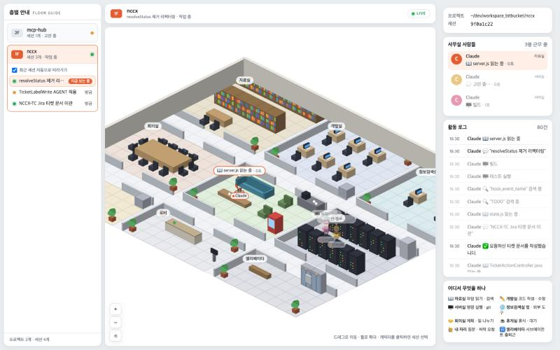

# AI Office

Claude Code 가 터미널에서 뭘 하고 있는지 한눈에 보려고 차린 사무실.

- 파일 읽을 땐 **자료실** 가서 책 펴고
- 명령 돌릴 땐 **서버실** 랙 앞에 서 있고
- 막히면 그 자리에서 턱 괴고 **고민 중…**
- 일을 나눠 맡기면 서브에이전트가 **엘리베이터** 타고 출근한다

전부 내 터미널의 Claude Code 세션들과 실시간으로 같이 움직인다. 프로젝트마다 층이 하나씩 생기고, 한 층에 그 프로젝트의 세션 전부가 보인다.



## 설치

Node 18 이상만 있으면 됩니다. Windows · macOS · Linux 공통 한 줄:

```bash
npx github:cozyuj/AI-office
```

이 한 줄이 (1) 앱을 `~/.ai-office/app` 에 복사하고 (2) `~/.claude/settings.json` 에 훅을 등록한 뒤 (3) 서버를 띄우고 브라우저를 엽니다. 다음부터는 같은 명령으로 서버만 다시 띄우면 됩니다. 훅은 **새로 시작하는** Claude Code 세션부터 적용됩니다.

다른 명령:

```bash
npx github:cozyuj/AI-office doctor            # Node·훅·포트 점검
npx github:cozyuj/AI-office start --port 4800 # 다른 포트 (훅도 AI_OFFICE_PORT=4800 으로 띄운 세션만 보임)
npx github:cozyuj/AI-office uninstall-hooks   # 훅 제거
```

레포를 받아서 쓰려면:

```bash
git clone git@github.com:cozyuj/AI-office.git && cd AI-office
node bin/ai-office.js        # 또는 npm run install-hooks && npm start
```

훅은 `node hooks/emit.js` 로 등록되어 셸이나 curl 이 없어도 동작합니다 (Windows 포함).

## 데모

실제 세션 없이 화면을 보고 싶으면 서버를 띄운 상태에서:

```bash
npm run demo            # 가짜 세션 4개가 사무실을 돌아다닌다
DEMO_SPEED=3 npm run demo
```

## 화면

| 영역 | 내용 |
|---|---|
| 좌측 층별 안내 | 프로젝트(cwd) = 층. 층을 열면 세션 목록. "최근 세션 자동으로 따라가기" 켜면 최신 활동 세션으로 선택이 옮겨감 |
| 중앙 사무실 | 드래그 이동, 휠/버튼 줌. 캐릭터 클릭 → 세션 선택. 📍 따라가기 = 카메라가 선택 세션의 Claude 를 쫓아감. 💬 말풍선 전체/선택만 |
| 우측 | 프로젝트 경로·세션 id, 사무실 사람들(방·말풍선·경과), 활동 로그, 범례 |

### 어디서 무엇을 하나

| 도구 | 방 | 말풍선 |
|---|---|---|
| Read, Grep, Glob | 📖 자료실 | `server.js 읽는 중`, `"TODO" 검색 중` |
| Edit, Write | ✏️ 개발실 | `app.js 수정 중` |
| Bash | 🖥️ 서버실 | `테스트 실행`, `npm test 실행 중` |
| WebSearch, WebFetch, MCP 도구 | 🌐 정보검색실 | `"tauri vs electron" 검색 중` |
| Agent, TodoWrite, Skill, Plan | 🤝 회의실 | `API 엔드포인트 찾기 맡기는 중` |
| AskUserQuestion, 허락 요청 | 🙋 내 자리 | `질문 있어요`, `허락이 필요해요` |
| Stop (턴 종료) | ☕ 휴게실 | `휴식 중` |
| SubagentStart / Stop | 🛗 엘리베이터 | 출근 / 퇴근 |

서브에이전트는 파란 안전모를 쓰고, Agent 도구에 적은 description 이 이름이 된다.

## 구조

```
Claude Code 세션 ─hooks─▶ hooks/emit.sh ─POST /hook─▶ server.js ─SSE /events─▶ public/ (canvas)
```

- `server.js` 훅 수신, 상태 머신 적용, SSE 중계, 정적 서빙
- `lib/normalize.js` 훅 payload 축소 + 도구 → 방/말풍선 해석
- `lib/state.js` 층/세션/캐릭터 상태 머신
- `lib/journal.js` 이벤트 JSONL 기록 + 기동 시 재생
- `public/js/scene/*` 아이소메트릭 맵·가구·캐릭터·A*·카메라
- `scripts/install-hooks.js` 훅 등록/제거, `scripts/demo.js` 데모

자세한 설계는 [docs/ARCHITECTURE.md](docs/ARCHITECTURE.md).

## 개발

```bash
npm test                # node --test (상태 머신 + 경로 탐색)
AI_OFFICE_PORT=4799 npm start
```

작업 흐름: GitHub 이슈를 `[BE-01]`, `[FE-01]` 처럼 FE/BE 로 나눠 만들고, `main` 에서 `feature/BE-01` 식 브랜치를 분리해 작업한 뒤 결과·테스트·캡처를 이슈 댓글로 남긴다.
